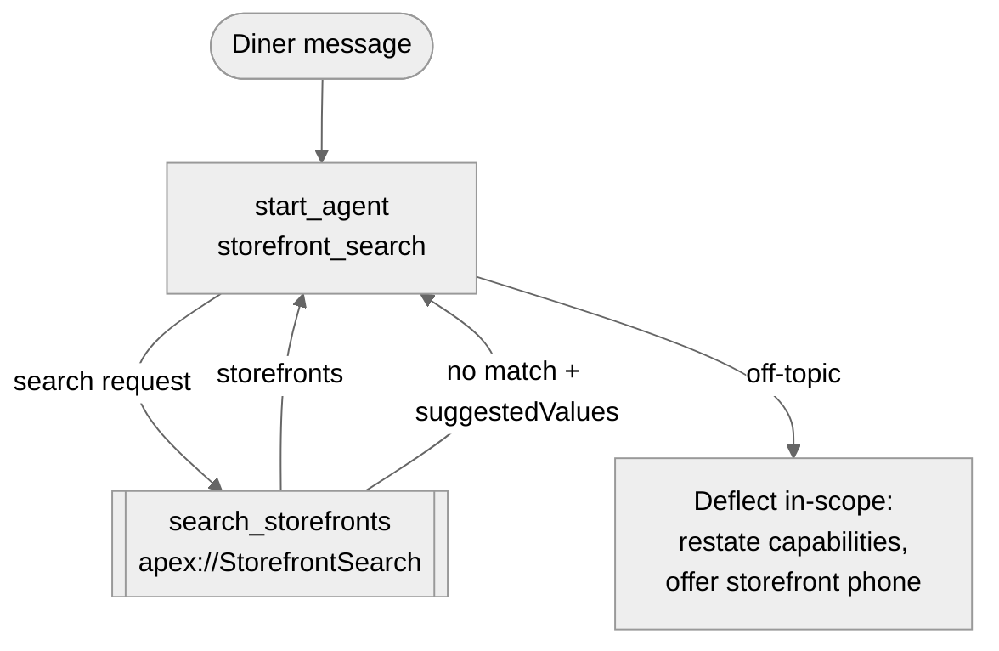

# Agent Spec: Storefront_Finder

## Purpose & Scope

Storefront Finder is a customer-facing service agent that helps anonymous
diners discover storefronts (restaurants, cafes, delis, and similar) by
cuisine, type of place, city, postal code, name, or minimum rating. It is
read-only and limited to storefront search in v1.

**Out of scope for v1:** menus and menu items, hours of operation, individual
review comments, orders, refunds, promotions, loyalty, and anything requiring
the diner's identity. These are deflected politely (see Behavioral Intent).

## Behavioral Intent

- **Audience:** anonymous diners on a public channel. The agent never asks for
  or uses personal information and has no identity verification.
- **What the agent needs before searching:** nothing mandatory. Every filter is
  optional. With no filters, the action returns the top-rated active
  storefronts, which serves "recommend something" requests.
- **Implementation type:** one invocable Apex action (`StorefrontSearch`).
- **Data exposure rules (enforced in Apex + permissions, not prompt text):**
  - Only `Status__c = 'Active'` storefronts are ever returned.
  - Only the fields in the `StorefrontInfo` DTO are returned. `Account__c`,
    `Primary_Contact__c`, `Total_Score__c`, geolocation, status, and record IDs
    are never returned.
  - The query runs in `AccessLevel.USER_MODE` as the agent user, so object
    permissions, FLS, and sharing apply.
- **Filter validation:** cuisine and type inputs are matched case-insensitively
  against the distinct values present on active storefronts (not the picklist
  definition, because org data uses values outside the picklist such as
  "Fine Dining", "Farm-to-Table", "Upscale Restaurant"). Partial matches are
  accepted ("japanese food" → "Japanese" if that value exists). If no match,
  the action returns no storefronts plus `suggestedValues` so the agent can
  offer real options.
- **Off-topic handling:** politely explain that the agent can only help find
  storefronts, restate what it can search by, and, when the request concerns a
  specific storefront already shown, suggest calling that storefront's phone
  number. No human escalation.
- **Grounding:** responses use the exact values returned by the action (names,
  ratings, phone numbers). The agent never invents storefronts, ratings, hours,
  menu items, or prices.
- **Conversational facts in surviving history (no variables):** the diner's
  stated preferences, previous search results, and refinements ("only ones
  rated 4+", "what about Plano?").
- **Deterministic runtime values:** none.

## Subagent Posture

| Subagent | Posture | Why this posture? | Deterministic controls |
|----------|---------|-------------------|------------------------|
| `storefront_search` (start_agent) | agentic | One focused objective with one read-only action; filters are extracted from natural language | none; data-exposure rules live in Apex and permissions |

## Subagent Map

Single execution block. Off-topic and ambiguity are branches in the same
instructions, not separate subagents: they share the same objective, have no
different actions or authority, and no escalation path.

## Variables

None. Surviving conversation history carries preferences and prior results.

## Actions

### search_storefronts (storefront_search)

- **Target:** `apex://StorefrontSearch`
- **Status:** NEEDS CREATION (functional implementation, approved: option A)

#### Inputs

| Name | Type | Required | Source |
|------|------|----------|--------|
| `cuisine` | string | No | Diner (e.g., "Italian", "vegan") |
| `storefrontType` | string | No | Diner (e.g., "cafe", "deli", "fine dining") |
| `city` | string | No | Diner (exact city, case-insensitive) |
| `postalCode` | string | No | Diner |
| `nameKeyword` | string | No | Diner (partial name match) |
| `minRating` | number | No | Diner ("4 stars or better"); 0–5 |
| `maxResults` | integer | No | Default 5, capped at 10 |

#### Outputs

| Name | Type | Visible to User? | Source | Notes |
|------|------|------------------|--------|-------|
| `storefronts` | list[object] | Yes | `Storefront__c` | `StorefrontInfo` DTOs, sorted by rating desc, nulls last, then name |
| `resultCount` | integer | No | Computed | Number returned |
| `suggestedValues` | list[string] | Yes | Distinct active cuisine/type values | Filled only when cuisine/type didn't match |
| `message` | string | No | Computed | Short machine-written explanation for the model (e.g., "No storefront type matched 'pizzeria'.") |

**`StorefrontInfo` fields:** `name`, `storefrontType` (`Type__c`), `cuisine`
(`Cuisine__c`), `street`, `city`, `stateCode`, `postalCode`, `phone`,
`averageRating` (`Average_Review_Score__c`), `totalReviews`
(`Total_Reviews__c`), `overview` (`Storefront_Overview__c`), `reviewSummary`
(`Review_Summary__c`).

> Street address is included because diners need to know where a storefront
> is; it is public business information. Drop it if you prefer city-only.

#### Implementation Requirements

- `public with sharing class StorefrontSearch` with one `@InvocableMethod`,
  inner `Request`, `Result`, and `StorefrontInfo` classes.
- `complex_data_type_name` for `storefronts`:
  `@apexClassType/c__StorefrontSearch$StorefrontInfo`.
- Dynamic SOQL via `Database.queryWithBinds(query, binds, AccessLevel.USER_MODE)`.
  All user values are bind variables. `nameKeyword` is LIKE-escaped (`%`, `_`, `\`).
- Cuisine/type resolution: one `USER_MODE` aggregate query for distinct values
  on active storefronts. Exact case-insensitive match wins; else a value
  contained in the input or the input contained in a value; else no search and
  return up to 8 suggestions.
- Bulk-safe: handles a list of requests (queries per request are bounded; the
  agent always sends one).
- Test class `StorefrontSearchTest` covering: each filter, active-only
  exclusion, no-filter top-rated, partial match, unmatched cuisine →
  suggestions, `maxResults` default and cap, LIKE escaping, and null rating
  ordering.

## Action Invocation Strategy

| Action | Subagent | Invocation Mode | Why |
|--------|----------|-----------------|-----|
| `search_storefronts` | `storefront_search` | Planner slot-fill (`with x = ...`) | Diner-initiated; the model extracts whichever filters were mentioned and re-searches on refinements |

Loop prevention: post-action instructions tell the model to answer from the
results and not call the action again until the diner changes or adds criteria.

## Deterministic Controls

None in Agent Script. Trust boundaries (active-only, field allowlist, read
access) are enforced in Apex and the permission set, which is stronger than an
`available when` gate for an anonymous channel.

## Security & Access

- **Agent user:** a dedicated new Einstein Agent User for this agent
  (`storefront_finder_agent@<org-domain>`) so its permissions stay minimal and
  separate from `Merchant_Support_Agent`. 193 of 201 Einstein Agent licenses
  are free.
- **Permission set `Storefront_Finder_Agent_Access`:**
  - Apex class access: `StorefrontSearch`
  - `Storefront__c`: Read only
  - Field read: `Name`, `Status__c` (filter only), `Type__c`, `Cuisine__c`,
    `Address__c` (compound, incl. street/city/state/postal), `Phone__c`,
    `Average_Review_Score__c`, `Total_Reviews__c`, `Storefront_Overview__c`,
    `Review_Summary__c`
  - No access to `Account`, `Contact`, `Review__c`, or menu objects in v1
- **Sharing:** `Storefront__c` internal OWD is Public Read/Write, so the agent
  user can see all records; `with sharing` + `USER_MODE` keep this correct if
  OWD tightens later.
- Plus the standard agent-user permissions required by Agentforce (per the
  agent user setup reference).

## Interaction Style

- Friendly, concise, helpful; plain language; no emojis.
- Lists of up to 5 storefronts by default: name, type, cuisine, city, rating
  (with review count), one-line overview, phone. Offer to narrow or show more.
- When no results: say so plainly, offer `suggestedValues` or suggest relaxing
  a filter (e.g., remove minimum rating).
- **Welcome message:** "Hi! I can help you find a place to eat. Tell me a
  cuisine, a kind of place, or a city, and I'll find options for you."
- **Error message:** "Sorry, something went wrong on my end. Please try again
  in a moment."

## Architecture Pattern

Single execution block: `start_agent storefront_search:` with its reasoning
and one action; zero `subagent` blocks. No router (one domain). Future v2
domains (menus, hours, reviews) would each be a candidate subagent behind a
router once they add distinct actions.

## Agent Configuration

- **developer_name:** `Storefront_Finder`
- **agent_label:** `Storefront Finder`
- **agent_type:** `AgentforceServiceAgent` (customer-facing, anonymous public channel)
- **access.default_agent_user:** dedicated new Einstein Agent User (username
  confirmed after creation)
- **Target org:** `afs40112oct`
- **Lifecycle:** draft only. Deploy, validate, and preview; no publish/activate
  without explicit approval. Channel wiring (Messaging for Web) is out of scope
  for this build.

## Validation Plan

1. Apex: deploy `StorefrontSearch`, then `StorefrontSearchTest`; run tests.
2. Agent: local compile (`index-agent.mjs`), then org validation of the bundle.
3. Preview (simulated, then live actions — read-only, safe in this dev org):
   - "Any Italian places in Dallas?" → search with cuisine + city
   - "Show me places rated 4 stars or better" → minRating only
   - "Recommend somewhere to eat" → no filters, top-rated
   - "Do you have sushi?" → no match → suggestions offered
   - "What about in Plano?" (follow-up) → refinement re-search
   - "What's on the menu at Urban Table?" → deflect + phone number
   - "I want a refund" → deflect, no escalation
